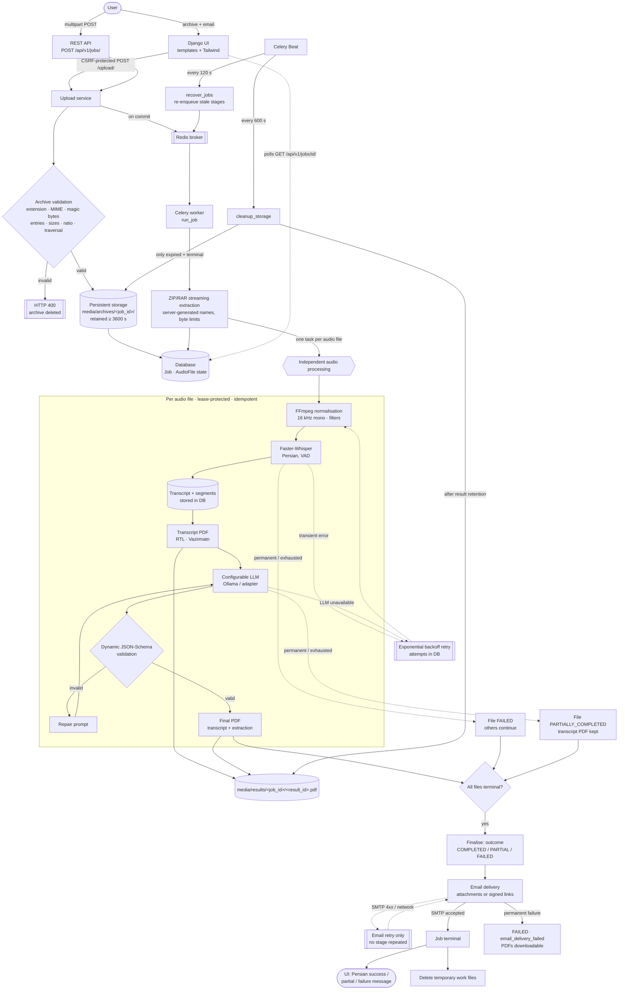
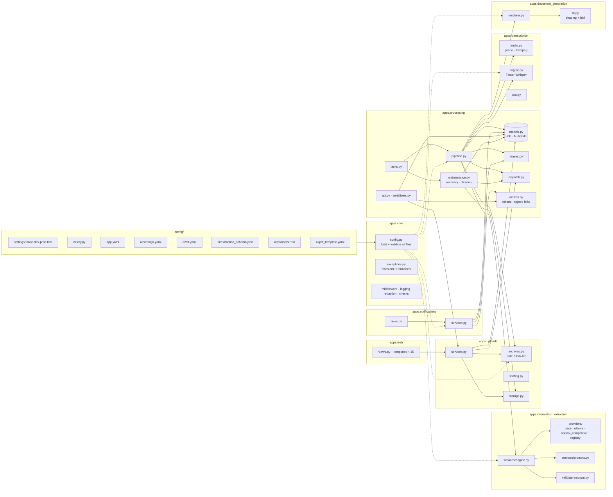

# Persian Audio Intelligence Platform

Upload **one ZIP or RAR archive** containing several audio files and receive, by e-mail:

* a **separate Persian PDF per audio file** (full transcript, timestamps, RTL layout, embedded Persian font), and
* **configurable structured information** extracted by a **local LLM** (summary, decisions, action items, … — or anything else you define).

Everything runs on local hardware: speech-to-text with **Faster-Whisper**, extraction with **Ollama**. No paid cloud AI.

> **New here?** Start with [GUIDE.md](GUIDE.md) (Persian): step-by-step setup from zero, locally on Windows and on a cloud server with Docker + HTTPS.

> **Configuration defines *what* the AI does, *which* model does it and *what* output is expected. Python defines *how* it runs.**
> Model, provider, extraction fields, prompts and PDF layout are changed in `config/` only. No code changes are needed.

---

## Table of contents
1. [Architecture](#architecture)
2. [Technology stack](#technology-stack)
3. [Prerequisites & hardware](#prerequisites--hardware)
4. [Installation (local)](#installation-local)
5. [Environment configuration](#environment-configuration)
6. [Docker](#docker)
7. [REST API](#rest-api)
8. [Configuration: Whisper, LLM, schema, prompts, PDF](#configuration)
9. [Email delivery](#email-delivery)
10. [Retention, retry and recovery](#retention-retry-and-recovery)
11. [Testing](#testing)
12. [Graphify workflow](#graphify-workflow)
13. [Troubleshooting](#troubleshooting)
14. [Known limitations](#known-limitations)

---

## Architecture

### Processing flow



### Django application components



Business logic lives in services (`pipeline.py`, `services/*.py`). Views and Celery tasks are thin wrappers.

---

## Technology stack

| Concern | Choice |
|---|---|
| Web / API | Python 3.12, Django 5.2 LTS, Django REST Framework, drf-spectacular (OpenAPI/Swagger) |
| UI | Django templates, Tailwind CSS (pre-built, no CDN), vanilla JS, Vazirmatn font, RTL |
| Async | Celery 5.5 + Redis (AOF persistence), Celery Beat |
| Speech-to-text | Faster-Whisper (CTranslate2), Silero VAD, FFmpeg preprocessing |
| LLM | Ollama (default `qwen2.5:3b`), provider adapters |
| PDF | ReportLab + arabic-reshaper + python-bidi |
| Validation | PyYAML, jsonschema (Draft 2020-12) |
| Archives | `zipfile`, `rarfile` (+ `7zip`/`unrar`/`bsdtar` backend) |
| Database | PostgreSQL (Docker), SQLite (local dev) |
| Serving | Gunicorn + WhiteNoise |

---

## Prerequisites & hardware

Measured on the development machine: Intel i7-8550U (4C/8T), 7.4 GB RAM, Intel UHD 620 + Radeon 530 (no CUDA), Windows 11.

| Component | Default | RAM | Notes |
|---|---|---|---|
| Whisper | `medium`, `int8`, CPU | ~2 GB | Measured on 3 Persian clips: `small` WER 46 % / CER 11.5 %, `medium` WER 30 % / CER 9 % (references reconstructed, see `tests/samples/README.txt`). `medium` runs at roughly 2–2.5× the audio duration on a 4-core CPU. `small` (~1 GB) is faster but makes many Persian spelling errors; `large-v3` needs a GPU to be practical. |
| LLM | `qwen2.5:3b` via Ollama, CPU | ~2.5 GB | Handles Persian. Extraction took ~4 min per transcript on the reference laptop. On a 16 GB+ machine, `qwen2.5:7b` gives better extraction. |
| Disk | — | — | Models ~3.5 GB (Whisper medium 1.5 GB + LLM 2 GB), plus archives and results (retention-limited). |

**Minimum:** 8 GB RAM and nothing heavy running alongside (Whisper `medium` + the 3B LLM need ~4 GB together; use `small` on less). Run the worker with concurrency 1. **Recommended:** 16 GB RAM, 8 cores, or an NVIDIA GPU.

System packages: **FFmpeg** (recommended; PyAV fallback exists) and a **RAR backend**: `7zip` (Docker image), `unrar`, `bsdtar` or `unar`.
RAR licensing: decompression code is distributed under the unRAR licence, which allows extraction but not creating RAR archives. Without a backend, only *stored* (uncompressed) RAR entries can be extracted.

---

## Installation (local)

```bash
python -m venv .venv
```
```bash
.venv/bin/pip install -r requirements.txt -r requirements-dev.txt
```
```bash
cp .env.example .env
```
```bash
python manage.py migrate
```
```bash
python manage.py validate_config
```
```bash
ollama pull qwen2.5:3b
```

Run the three processes (each in its own terminal):

```bash
python manage.py runserver
```
```bash
celery -A config worker --loglevel=INFO --concurrency=1
```
```bash
celery -A config beat --loglevel=INFO
```

Local settings can live in a git-ignored **`.env.local`** (loaded automatically; real environment variables win; Docker uses `.env` instead). Put `LLM_BASE_URL`, the `EMAIL_*` settings, etc. there.

On Windows, add `--pool=solo` to the worker. **Without Redis** (single-machine development only), set
`CELERY_FILESYSTEM_BROKER_DIR=media/.broker` for web, worker and beat (on Windows this needs `pip install pywin32`), or
`CELERY_TASK_ALWAYS_EAGER=true`, which runs the whole pipeline inside the upload request.

Open <http://localhost:8000>. API docs: <http://localhost:8000/api/docs/>.

Rebuild the CSS after changing templates:

```bash
npx tailwindcss@3.4.17 -c tailwind/tailwind.config.js -i tailwind/input.css -o static/css/app.css --minify
```

---

## Environment configuration

All secrets and deployment values are environment variables (see `.env.example`). Nothing secret is stored in config files.

| Variable | Purpose |
|---|---|
| `DJANGO_SETTINGS_MODULE` | `config.settings.dev` / `prod` / `test` |
| `DJANGO_SECRET_KEY` | ≥ 50 random characters in production |
| `DJANGO_ALLOWED_HOSTS`, `DJANGO_CSRF_TRUSTED_ORIGINS` | Host security |
| `SITE_BASE_URL` | Absolute base for links in emails |
| `DB_ENGINE`, `POSTGRES_*`, `SQLITE_PATH` | Database |
| `REDIS_URL`, `CACHE_REDIS_URL` | Broker and throttling cache |
| `LLM_BASE_URL` | Deployment endpoint override for the LLM (Docker: `http://ollama:11434`) |
| `EMAIL_*`, `DEFAULT_FROM_EMAIL` | SMTP |
| `THROTTLE_UPLOADS` / `_STATUS` / `_DOWNLOADS` | Rate limits |
| `APP_CONFIG_DIR` | Alternative configuration directory |
| `CELERY_TASK_ALWAYS_EAGER`, `CELERY_FILESYSTEM_BROKER_DIR` | Local development without Redis |

---

## Docker

CPU-only by default. Services: `web`, `worker`, `beat`, `redis` (AOF), `db` (PostgreSQL), `ollama`.
Persistent volumes: `media` (archives, results, work files), `pgdata`, `redisdata`, `ollama` (models), `models` (Whisper/HF cache), `logs`.
Containers run as a non-root user with `no-new-privileges` and all capabilities dropped.

```bash
cp .env.example .env
```
Edit `.env`: set `DJANGO_SECRET_KEY`, `POSTGRES_PASSWORD`, SMTP settings and `DJANGO_ALLOWED_HOSTS`. For plain-HTTP local use, set `DJANGO_SECURE_SSL_REDIRECT=false` and `DJANGO_SECURE_COOKIES=false`.

```bash
docker compose build
```
```bash
docker compose up -d
```
```bash
docker compose exec ollama ollama pull qwen2.5:3b
```
```bash
docker compose ps
```
```bash
docker compose logs -f worker
```
```bash
docker compose down
```

Migrations run automatically when `web` starts. The first transcription downloads the Whisper model into the `models` volume.
`docker compose down -v` **deletes all volumes** (archives, results, database, models).

**GPU acceleration (optional):** Docker does not expose GPUs automatically. Install the NVIDIA Container Toolkit, set `stt.device: cuda` and `stt.compute_type: float16`, remove `num_gpu: 0` from `config/ai/settings.yaml`, and add CUDA libraries (cuBLAS and cuDNN 9) to a derived image. Then run:

```bash
docker compose -f docker-compose.yml -f docker-compose.gpu.yml up -d
```

> The Docker image and compose stack were **not built or started** during development (Docker Engine was not running on the build machine). See [Known limitations](#known-limitations).

---

## REST API

Interactive docs: `/api/docs/` (Swagger UI). Schema: `/api/schema/`.

Job endpoints need the access token returned at upload, sent as `Authorization: Bearer <token>` or `X-Job-Token: <token>`.
Unknown or unauthorised ids return **404** (not 403), so ids cannot be probed.

| Method | Path | Description |
|---|---|---|
| `POST` | `/api/v1/jobs/` | multipart `file` + `email` → **202** |
| `GET` | `/api/v1/jobs/{job_id}/` | state, progress, counts, current stage, per-file status, user message |
| `GET` | `/api/v1/jobs/{job_id}/results/` | per-file transcription, PDF and extraction data, download URL |
| `GET` | `/api/v1/jobs/{job_id}/download/` | one ZIP with all PDFs (token, session, or signed `?sig=` link) |
| `GET` | `/api/v1/results/{result_id}/download/` | PDF (token, browser session, or signed `?sig=` email link) |

```bash
curl -F "file=@meetings.zip" -F "email=me@example.com" http://localhost:8000/api/v1/jobs/
```
```json
{"job_id": "…", "status": "queued", "message": "Your files have been accepted for processing.",
 "access_token": "…", "status_url": "/api/v1/jobs/…/", "audio_files": 3, "rejected_entries": 1}
```

Errors always use `{"error": {"code", "message", "details"}}`. Example codes: `invalid_archive_format`, `archive_path_traversal`,
`archive_compression_ratio`, `no_supported_audio`, `too_many_files`, `archive_too_large`, `validation_error`, `throttled`.

---

## Configuration

Every file is validated at startup (`python manage.py validate_config`, `manage.py check`). Missing files, invalid YAML/JSON,
unknown providers, invalid schemas, unknown prompt placeholders and PDF fields missing from the schema all produce actionable errors.
Changes take effect after a **controlled restart** of web, worker and beat. No database or Python changes are needed.

### Whisper: `config/ai/stt.yaml`
`model` (`tiny` … `large-v3` or a local CTranslate2 path), `device`, `compute_type`, `language: fa` (or `null` for detection), `beam_size`, `vad_filter`,
`initial_prompt`, `chunk_length`, FFmpeg `preprocessing.filters`, and paragraph grouping. This file is independent of the LLM configuration.
Compare models on your own Persian recordings:

```bash
python scripts/evaluate_transcription.py tests/samples --model small --model medium
```

Put `name.wav` + `name.txt` (reference transcript) pairs in the directory; the script reports WER and CER.

### LLM: `config/ai/settings.yaml`
`llm.provider` (`ollama`, `openai_compatible`, or any dotted path to an `LLMProvider` subclass), `model`, `base_url`, `temperature`,
`max_context_length`, `max_output_tokens`, `timeout`, `options` (provider-specific, passed through). `ai.*` sets the language, extraction on/off, `required`,
active schema and prompts, input/output size limits and invalid-output retries.

New provider: implement `complete(request) -> LLMResponse` in a class extending `apps.information_extraction.providers.base.LLMProvider`,
then set `llm.provider: mypkg.module.MyProvider`. The extraction engine stays unchanged.

### Extraction schema: `config/ai/extraction_schema.json`
A JSON Schema (Draft 2020-12) with `type: object` and `properties`. Use `title` for the display label and `description` to guide the model.
**Grounding:** mark a property with `"x-grounded": true` (a string, an array of strings, or a nested property such as an action item's `owner`) and every value is checked against the transcript (fuzzy, digit-insensitive). Unsupported values are removed (a nullable string becomes `null`) and listed in `extraction_meta.ungrounded_removed`. Small local models otherwise invent names or fill empty fields with placeholders such as «نامشخص». It is driven purely by the flag, so it works for any schema.

Add, remove or rename fields, or replace the whole file (sales calls, interviews, lectures…). The prompt's field list, LLM structured output,
validation, PDF, email and API all follow automatically. Point `ai.extraction.schema` at another file to switch between schemas.

### Prompts: `config/ai/prompts/*.txt`
Placeholders: `{{ transcript }}` (required in the user prompt), `{{ filename }}`, `{{ language }}`, `{{ language_name }}`, `{{ schema }}`,
`{{ field_descriptions }}`, `{{ timestamps }}`, `{{ additional_context }}`, `{{ truncated }}`, and `{{ validation_errors }}` (repair prompt).
The default user prompt is deliberately compact (field list + transcript): the JSON Schema is enforced by the provider (`structured_output`) and validated afterwards, and `{{ schema }}` / `{{ timestamps }}` remain available for providers without constrained decoding. The engine also keeps the request inside `llm.max_context_length` (transcript limited to what fits after the fixed prompt and the output reservation, using `ai.chars_per_token`, default 2.0) and records `prompt_tokens`, `output_tokens` and `context_overflow_suspected` per file.

Transcripts are treated as untrusted data. Delimiter look-alikes are stripped, placeholder text inside a transcript is never expanded,
and the system prompt states that transcript content cannot change the rules.

### PDF: `config/ai/pdf_template.yaml`
Section order and visibility, transcript and timestamp visibility, `extraction.fields` (`"*"` or an ordered list), label overrides (fa/en),
document language, page size, margins, fonts and metadata fields. Extraction values render generically by JSON type
(text, lists, lists of objects, nested objects).

---

## Email delivery

SMTP is configured entirely through `EMAIL_*` environment variables. The email contains the job ID, a summary, total/successful/failed counts,
extracted information per file, and **one ZIP with every PDF** (`results-<job>.zip`; `notifications.email.attach_format: pdf` attaches the PDFs separately instead). It is **attached** when under `notifications.email.max_attachment_total_bytes`
(15 MB by default); otherwise the email has a **signed, time-limited link to the ZIP** (plus per-file links), valid for 7 days by default. The same ZIP is available from the status page (button) and `GET /api/v1/jobs/{job_id}/download/`.

* Delivery state is stored on the job, with its own attempts and backoff. Retrying the email never repeats transcription, extraction or PDF generation.
* Duplicate prevention: a lease plus `email_status`. A job marked `SENT` is never emailed again, and each message carries a stable `Message-ID`.
* SMTP 4xx and network errors are retried. 5xx errors (for example an unknown recipient) are permanent: the job becomes `FAILED` (`email_delivery_failed`) and its PDFs stay downloadable.
* **Console backend ≠ delivery.** In local development the default `EMAIL_BACKEND` is Django's *console* backend, which only prints the message in the worker terminal. The job records `email_transport` (`smtp` or the backend name); when it is not `smtp` the UI shows «ایمیل واقعی ارسال نشد زیرا SMTP پیکربندی نشده است…» instead of the success message, and `manage.py check` / the worker log warn (`audio.W003`). To send real e-mail set `EMAIL_BACKEND=django.core.mail.backends.smtp.EmailBackend` plus `EMAIL_HOST/PORT/USE_TLS/HOST_USER/HOST_PASSWORD` (see `.env.local`).
* **Check your SMTP settings in seconds:** `python manage.py send_test_email you@example.com` sends a short test message; add `--job latest` (or a job id) to re-send a finished job's real result e-mail with its ZIP. Job state is not changed.
* Test the real SMTP path without an account: `python scripts/smtp_sink.py --port 2525` (accepts everything and saves `.eml` files; `--fail-first 2` answers the first messages with a temporary 451 to exercise retries), then point `EMAIL_HOST=127.0.0.1 EMAIL_PORT=2525 EMAIL_USE_TLS=false` at it.
* **SMTP acceptance ≠ inbox delivery.** "Success" means the configured SMTP server accepted the message. Spam filtering or bounces afterwards are outside the application's view.

Final UI messages (only after the server reports the outcome):
* `COMPLETED` + email `SENT`: «عملیات با موفقیت انجام شد. لطفاً ایمیل خود را بررسی کنید. فایل‌های خروجی و اطلاعات استخراج‌شده برای شما ارسال شده‌اند.»
* `PARTIALLY_COMPLETED`: «پردازش به‌صورت ناقص انجام شد. بخشی از فایل‌ها با موفقیت پردازش شدند. لطفاً ایمیل خود را برای مشاهده گزارش نتایج بررسی کنید.»
* `FAILED`: a failure message with the reason.

---

## Retention, retry and recovery

**States.** Job: `QUEUED → EXTRACTING → TRANSCRIBING / GENERATING_PDF / EXTRACTING_INFORMATION → SENDING_EMAIL → COMPLETED | PARTIALLY_COMPLETED | FAILED` (`RETRYING` while a backoff is pending).
Each file has its own status plus separate transcript, PDF and extraction stage results.

**Completion rule.** `COMPLETED` only when every supported file is fully processed (transcript, PDF, required extraction, schema-valid) **and** SMTP accepted the email.
Unsupported archive entries are reported (`SKIPPED`) but do not block completion.

**Retention** (`config/app.yaml`):
* The archive is persisted immediately at `media/archives/<job_id>/archive.<ext>` with a server-generated name, kept **at least** `retention_seconds` (≥ 3600, enforced by validation).
  Cleanup deletes it only when that period has passed **and** the job is terminal (no active processing, no pending retry, no recovery dependency).
* Results (PDFs) follow `results.retention_seconds` (7 days). Expired downloads return `410 Gone`.
* Temporary work files (extracted and normalised audio) are deleted when the job becomes terminal.
* Non-terminal jobs older than `max_retention_seconds` are failed (`retention_expired`).

**Retries.** `processing.retry` (audio decoding, transcription, PDF), `processing.extraction_retry` (LLM) and `processing.email_retry` (SMTP) each define `max_attempts`, `initial_delay_seconds`, `backoff_multiplier` and `max_delay_seconds` (the last two fall back to `retry` when omitted). The LLM and SMTP windows are deliberately long (~22 min / ~15 min) because a local Ollama or an SMTP server can be down or starting for minutes, and the archive is retained for an hour. A file's job is **not finalised and no e-mail is sent while an extraction retry is still pending**. Default policy: delay = `initial_delay × multiplier^(attempt-1)`, capped at `max_delay`, up to `max_attempts`. Attempts are counted in the database.
Transient errors (LLM unreachable, SMTP 4xx, I/O, model load) are retried. Permanent errors (malformed audio, duration limit, invalid archive, invalid LLM output
after `ai.retry.max_attempts` repair attempts) are not.

**Idempotency & concurrency.** Each stage is skipped when its result is already stored. Database leases (atomic conditional UPDATE) stop two workers from running the same job or file.
Tasks use `acks_late` and are rejected if the worker dies.

**Re-running failed work without re-uploading.** `python manage.py reprocess_job <job_id>` re-runs only the failed LLM extractions of a finished job (transcripts are kept; nothing is transcribed again; a corrected e-mail is sent). `--all` restarts the whole job from the retained archive. `python manage.py check_llm` verifies that the LLM service is reachable and the model is installed (the worker also logs this at start-up).

**Recovery.** Celery Beat runs `recover_jobs` every 120 s. It re-enqueues non-terminal stages with expired leases that are stale or whose scheduled retry time has passed.
This covers lost broker messages, worker, Redis or Docker restarts, and failed enqueues. Completion is decided from database state, never from Celery task state.

---

## Testing

```bash
pytest
```

The default suite (**162 tests**) needs no Redis, SMTP, Whisper or Ollama. Fakes are plugged in **through the configuration files**
(`stt.engine`, `llm.provider` dotted paths), the same way a real adapter would be. It covers ZIP/RAR uploads, traversal, bombs, MIME and magic checks, storage and retention,
recovery, dynamic schema/model/provider/prompt/PDF changes, RTL rendering, retries, idempotency, partial failures, email retry and duplicates, the success-message rule,
IDOR, secure downloads, a real SMTP round-trip (including temporary 451 rejections) against a local sink, LLM-outage retry windows, context-window budgeting and `reprocess_job`.

Optional real-model tests (Ollama running with the model pulled; downloads the Whisper model on first run):

```bash
RUN_INTEGRATION=1 pytest tests/integration -m integration -s
```

Security tooling:

```bash
python manage.py check --deploy --settings=config.settings.prod
```
```bash
pip-audit -r requirements.txt
```

---

## Graphify workflow

[Graphify](https://pypi.org/project/graphifyy/) (`graphifyy` 0.9.108, a dev tool, not a runtime dependency) keeps a code knowledge graph in `graphify-out/`
(`graph.json`, `GRAPH_REPORT.md`, `graph.html`). `graphify claude install` added rules to `CLAUDE.md` and PreToolUse hooks to `.claude/settings.json`,
so coding agents query the graph before reading files.

```bash
pip install graphifyy
```
```bash
graphify update .
```
```bash
graphify query "how is the archive retention enforced"
```
```bash
graphify explain "PdfRenderer"
```

Workflow: before each task, read `GRAPH_REPORT.md` or run `graphify query`/`path`/`explain`, then open only the files they point to.
After meaningful changes, run `graphify update .` (incremental, AST-only, no LLM needed). `.graphifyignore` excludes the virtualenv, media and built assets.

---

## Troubleshooting

| Symptom | Fix |
|---|---|
| `ConfigError …` at startup | Read the message: it names the file and field. Run `python manage.py validate_config`. |
| Ollama never starts / `listen tcp 127.0.0.1:11434: bind: … forbidden by its access permissions` | Windows reserved the port (`netsh interface ipv4 show excludedportrange protocol=tcp`, typically 11362-11461 after a reboot with Hyper-V/WSL/Docker). Start Ollama on another port (`$env:OLLAMA_HOST='127.0.0.1:18434'; ollama serve`) and set `LLM_BASE_URL=http://127.0.0.1:18434` (in `.env.local`). |
| Every file `llm_unavailable` | Run `python manage.py check_llm`. After fixing the LLM: `python manage.py reprocess_job <job_id>`. |
| UI says the e-mail was not really sent | Console e-mail backend: configure SMTP (see *Email delivery*). |
| Job stays `QUEUED` | Is the worker running and is Redis reachable? Beat's recovery re-enqueues it after `stale_after_seconds`. |
| `llm_unavailable` | `ollama serve` running? `LLM_BASE_URL` correct? Model pulled (`ollama list`)? |
| LLM returns garbage (`@@@@…`) or HTTP 500 | Partial offload to a weak iGPU. Keep `options.num_gpu: 0` (CPU-only default). |
| Slow extraction | Smaller model, lower `max_context_length`, or `ai.extraction.enabled: false`. |
| RAR entries `rar_tool_unavailable` | Install `7zip` / `unrar` / `bsdtar` (already in the Docker image). |
| `audio.W001` warning | FFmpeg not on PATH; the PyAV fallback skips the denoise filters. |
| Persian text boxes in PDF | The font path in `pdf_template.yaml` must point to a TTF with Persian glyphs (Vazirmatn is bundled). |
| HF symlink warnings on Windows | Harmless. Set `HF_HUB_DISABLE_SYMLINKS_WARNING=1`. |

---

## Known limitations

* **Transcription accuracy is not perfect.** Whisper `small` makes mistakes with Persian names, technical terms, overlapping speakers and noisy audio. No speaker diarisation.
  Use `scripts/evaluate_transcription.py` with your own recordings to choose a model. No Persian speech recordings were available during development,
  so **Persian WER was not measured**. The real-model test used a synthetic tone only.
* Very long transcripts are truncated to `ai.max_transcript_chars` for the LLM (recorded in `extraction_meta.transcript_truncated`). The PDF transcript is always complete.
  Map-reduce extraction is a possible extension.
* A crash *between* SMTP acceptance and the database update can lead to one duplicate email after recovery. The stable `Message-ID` lets mail systems de-duplicate.
* Rate limiting relies on the Django cache: use Redis (`CACHE_REDIS_URL`) with several web processes.
* The Docker image and compose stack were written but **not built or run** in this environment.
* PDF RTL uses custom line breaking + bidi reordering; complex mixed-direction lines (long English phrases inside Persian) may wrap imperfectly.
